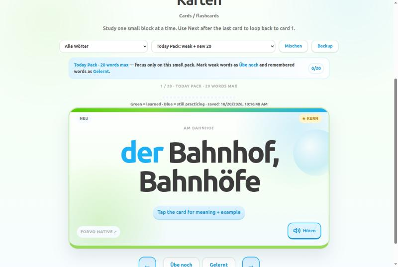
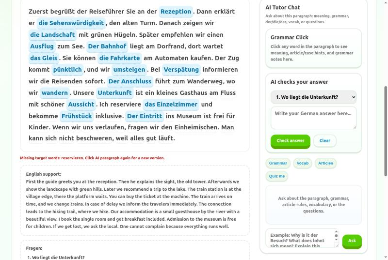
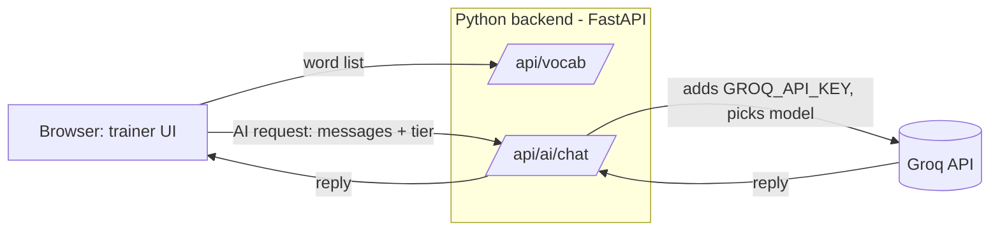

# Mosel Wortschatz

**A German B1 vocabulary and grammar trainer with an AI tutor.** Flashcards, article drills, quizzes, typing practice, sentence building, and AI-written reading texts built from the exact words you are learning, with a tutor that explains the grammar.

[](https://github.com/Sanojkumar21/mosel-wortschatz/actions/workflows/ci.yml)
[](LICENSE)

**Live:**
- **Full version, with the Python backend:** https://mosel-wortschatz.onrender.com (AI is built in; it asks for an access code. Free hosting sleeps when idle, so the first load can take about 50 s.)
- **Static version:** https://sanojkumar21.github.io/mosel-wortschatz/ (no server; AI features use your own free Groq key)



## Why I built it

I'm learning German for the Goethe B1 exam. Word lists alone don't stick, and generic apps don't use *my* list. This trainer drills the words I'm actually studying, then asks an LLM to write a short reading text that uses all of them, asks comprehension questions, checks my answers and explains the grammar. It started as one HTML file; this repository is the cleaned-up version with a small Python backend so the API key never has to live in the browser.

## Features

| Tab | What it does |
|---|---|
| **Suche** (Word Search) | search your list; the AI explains meaning, grammar, plural, usage |
| **Karten** (Cards) | flashcards in small daily packs; mark words "still practicing" or "learned" |
| **Artikel** | der / die / das drills with gender rules |
| **Quiz**, **Abruf**, **Paaren**, **Tippen** | multiple choice, English → German recall, matching, typing |
| **Sätze** (Sentences) | build sentences with the word; curated fixes for tricky separable verbs |
| **Absatz** (Paragraph) | AI writes a B1 reading text using every word in your pack, then asks and checks questions; a tutor chat explains grammar |
| **Fortschritt** (Progress) | progress per chapter; backup and restore to a JSON file |

- Pronunciation with the browser's German voice (online fallback).
- Progress is saved in your browser, with an automatic backup and export/import.
- Works on phones.



## How it works



Two ways to run it:

| | With the Python backend | Static (GitHub Pages, or `index.html` from disk) |
|---|---|---|
| Groq key | on the server, in `.env`; never sent to the browser | each learner pastes their own; sent only to Groq |
| Word list | yours (`data/private/`) or the sample | the sample, or one you import in the page |
| Protection | rate limits, request size limits, optional access code | n/a |

The browser code doesn't care which: `web/js/api.js` checks `/api/health` and routes AI calls to the server when it exists, otherwise straight to Groq with the learner's key.

**Reliability built in (both modes):**
- **Model failover.** Models are tried in order (`gpt-oss-120b` → `gpt-oss-20b` → `qwen3.8-27b`). A retired model (404), exhausted quota (429), overload (5xx) or oversized request moves on to the next one.
- **Wrong-script filter.** A German tutor must never answer in Chinese characters, which Qwen occasionally does at high temperature. Such replies are discarded and the next model answers.
- **Reasoning models handled.** `gpt-oss` thinks before answering and the thinking counts against the token limit, so it gets light reasoning plus extra token room. An empty answer moves to the next model.
- **Strict JSON fallback.** If Groq's strict JSON mode rejects a reply, the same model is asked again without it; the app extracts JSON from plain text itself.
- **Unsupported parameters** (penalties, JSON mode) are dropped and retried instead of failing.

## Run it locally

```bash
git clone https://github.com/Sanojkumar21/mosel-wortschatz.git
cd mosel-wortschatz
make setup        # virtualenv + dependencies + .env from .env.example
# put your free Groq key (https://console.groq.com/keys) in .env as GROQ_API_KEY=...
make serve        # http://127.0.0.1:8000
```

Without a key everything except the AI features still works, and the AI features then ask for a key in the page.

### Use your own word list

Your list stays on your machine: everything in `data/private/` is git-ignored.

```bash
python scripts/import_html.py path/to/old-single-file-trainer.html   # or write data/private/vocab.json yourself
```

Format (`data/private/vocab.json`; `examples_en.json` with `{"<word id>": "English example"}` is optional):

```json
[{"number": 1, "title": "Unterwegs", "title_en": "On the road",
  "words": [{"id": 1, "term": "der Bahnhof, Bahnhöfe", "translation": "train station",
             "example": "Der Bahnhof liegt mitten in der Stadt.", "core": true, "section": "Am Bahnhof"}]}]
```

On the hosted static site, **"Use my own word list (JSON)"** in the footer loads a list into your browser only.

## Deploy

**Static site (free, no server):** pushed to `main` → GitHub Actions builds `_site/` (trainer + sample list) and deploys it to GitHub Pages. Locally: `make static`.

**With the backend:**
- **Render (free plan):** [](https://render.com/deploy?repo=https://github.com/Sanojkumar21/mosel-wortschatz). Then set `GROQ_API_KEY` (and `ACCESS_CODE` if the site is public) in the service's Environment tab. `render.yaml` holds the rest.
- **Docker, anywhere:** `make docker` or `docker build -t mosel-wortschatz . && docker run -p 8000:8000 --env-file .env mosel-wortschatz`.

### Configuration

| Variable | Default | Purpose |
|---|---|---|
| `GROQ_API_KEY` | (empty) | enables server-side AI |
| `GROQ_MODELS_QUALITY` | `openai/gpt-oss-120b,openai/gpt-oss-20b,qwen/qwen3.8-27b` | models for reading texts, chat, answer checks |
| `GROQ_MODELS_FAST` | `openai/gpt-oss-20b,openai/gpt-oss-120b,qwen/qwen3.8-27b` | models for word lookups |
| `ACCESS_CODE` | (empty) | require a code for AI requests on a public deployment |
| `RATE_PER_MINUTE` / `RATE_PER_DAY` | `12` / `300` | AI requests per visitor |
| `DAILY_CAP` | `1500` | AI requests per day for the whole server |
| `TRUST_PROXY` | `0` | `1` behind Render / Fly / nginx, so limits see the real client IP |
| `HOST` / `PORT` | `127.0.0.1` / `8000` | where to listen |

API docs: `/api/docs` when the server is running.

## Project structure

```
mosel/            FastAPI backend: config, word-list loader, Groq client with failover, rate limiter
web/              the trainer: index.html, css/, js/api.js (AI + data client), js/boot.js, js/app.js
data/sample/      a small original word list (public)
data/private/     your own word list (git-ignored)
scripts/          import_html.py (from the old single file), build_static.py (GitHub Pages build)
tests/            pytest (backend, with a fake Groq) and node --test (browser client)
```

## Tests

```bash
make test     # pytest + node --test
make lint     # ruff
```

The tests never call Groq: a fake Groq checks failover, the wrong-script filter, parameter fallbacks, rate limits, the access code, input limits, and that the key never reaches the browser.

## Privacy and limitations

- The Groq key stays on the server (backend mode) or in your browser (static mode, only if you tick "save").
- Text you send to the AI is processed by Groq.
- The online pronunciation fallback uses Google Translate's public text-to-speech endpoint, which is unofficial and may stop working; the browser voice is used first.
- Rate limits are in memory: fine for one process, not shared across several.
- AI explanations can be wrong. Double-check grammar explanations against a textbook or teacher.

## License

[MIT](LICENSE). The sample word list was written for this project. Bring your own list for your course; publishing a textbook's word list may require the publisher's permission.
